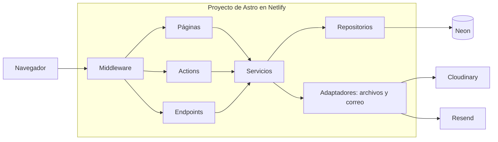

# Arquitectura

> Describe el diseño previsto. Hoy solo existen el esqueleto de Astro, el esquema de la base de datos, el acceso con usuario y contraseña, la protección de rutas por rol y el almacenamiento y la descarga de archivos (todavía sin pantallas para subirlos).

Todo vive en un único proyecto de Astro desplegado en Netlify. Ese proyecto habla con tres servicios externos: Neon para los datos, Cloudinary para los archivos y Resend para los correos. No hay un backend separado, y todos los servicios están en su plan gratuito.

Cada petición pasa primero por el middleware y luego llega a un controlador: una página, una Action o un endpoint. Solo la capa de dominio (`src/lib/`) habla con Neon, Cloudinary y Resend. Los archivos siempre pasan por el servidor de la app: el navegador nunca recibe una URL de Cloudinary.

## Capas del proyecto

- **Middleware** (`src/middleware.ts`): lee la sesión de Better Auth, guarda el usuario en `locals.user` y bloquea las rutas según el rol. `/admin/*` es solo para la administradora y `/app/*` para los inquilinos; con el rol equivocado se redirige al área propia. También obliga a cambiar la contraseña temporal y renueva la cookie de sesión. Las reglas están en `src/lib/route-access.ts`. Protege rutas, no Actions: cada Action revisa sus permisos.

El servidor sigue el flujo `controlador → servicio → repositorio` ([decisión 017](decisions/017-layers-dependency-injection.md)).

**Controladores**: traducen entre HTTP y los servicios. No tienen reglas de negocio ni consultas, y nunca usan un repositorio.

- **Páginas** (`src/pages/`): se generan en el servidor con los datos que piden a un servicio. Casi no llevan JavaScript en el navegador.
- **Actions** (`src/actions/`): cada formulario llama a una Action, que valida los datos con Zod, revisa permisos, llama a un servicio y convierte sus errores en mensajes. También maneja las cookies.
- **Endpoints** (`src/pages/api/`): el handler de Better Auth (`/api/auth/[...all]`) y la descarga de archivos (`/api/files/[publicId]`).

**Dominio** (`src/lib/`):

- **Servicios** (`src/lib/services/`): reglas de negocio. Reciben repositorios y adaptadores por el constructor. No importan `db`, `astro:env` ni instancias concretas; solo sus tipos.
- **Repositorios** (`src/lib/repositories/`): las consultas propias con Drizzle. Reciben `db` por el constructor. Cada uno exporta la interfaz que usan los servicios y su implementación.
- **Adaptadores**: Better Auth (`auth.ts`) almacenamiento de archivos (`storage.ts`) y, cuando exista, correo (`sendEmail()`). Better Auth consulta sus tablas con su propio adaptador.
- **Composición** (`src/lib/container.ts`): único lugar que crea servicios y repositorios y les pasa sus dependencias. Los controladores toman los servicios de aquí.

La generación del PDF firmado va en la capa de dominio.

## Acceso

Los formularios de acceso, cambio de contraseña y cierre de sesión llaman a Actions, que usan `AuthService` (este llama a `auth.api`) y trasladan la cookie de sesión. El registro está cerrado. Por HTTP están desactivadas `/api/auth/change-password` (el cambio pasa por la app para actualizar `must_change_password`), `/api/auth/update-user` y `/api/auth/is-username-available`.

## Firma del contrato

1. La administradora sube el PDF del contrato ya firmado por ella (máximo 3.5 MB, para dejar margen al PDF firmado). El servidor calcula su SHA-256 y el contrato queda en estado "por firmar".
2. El inquilino lo lee en su celular, marca "Leí y acepto el contrato" y firma con el dedo en la isla de React (signature\_pad).
3. La Action recibe la firma como PNG, vuelve a revisar la sesión y que el contrato sea suyo, y con pdf-lib agrega la firma y una página de constancia. La constancia incluye nombre, usuario, fecha y hora, IP, navegador y el SHA-256 del documento original. El contrato lleva una cláusula en la que el inquilino reconoce esa cuenta como suya y acepta firmar electrónicamente con ella.
4. Se guarda el PDF firmado en Cloudinary, el contrato pasa a "firmado" y Resend avisa a la administradora. El inquilino descarga su copia desde la plataforma.

## Subida de archivos

- Cada petición con archivos tiene un tope de unos 4 MB. Netlify admite [unos 4.5 MB de datos binarios](https://docs.netlify.com/build/functions/configuration/) por petición.
- Astro limita las Actions a 1 MB por defecto. Al crear la primera Action con archivos hay que ajustar [`security.actionBodySizeLimit`](https://docs.astro.build/en/reference/configuration-reference/#securityactionbodysizelimit) a ese tope.
- Las fotos se reducen en el navegador como mejora progresiva. Sin JavaScript, el formulario funciona si los archivos caben.
- El límite se indica junto al campo, y con JavaScript el tamaño se revisa antes de enviar. Sin JavaScript, un envío que Netlify rechace por tamaño no llega a la app, así que no se puede mostrar un mensaje propio.
- El PDF original del contrato se limita a 3.5 MB.

## WiFi

La administradora cambia la contraseña en la app de Omada y la escribe en la plataforma. Se guarda cifrada con AES-GCM, con una llave en una variable de entorno. El inquilino solo la ve mientras su contrato esté firmado y vigente.

## Correo

- Se empieza sin dominio propio: el remitente (`MAIL_FROM`) es `onboarding@resend.dev`.
- Ese remitente [solo envía al correo de la cuenta de Resend](https://resend.com/docs/knowledge-base/403-error-resend-dev-domain), así que la cuenta se registra con el mismo correo que `ADMIN_EMAIL`. Puede ser de Gmail o Hotmail.
- No se puede enviar desde una dirección `@gmail.com` ni `@hotmail.com`: Resend exige verificar el dominio del remitente por DNS y esos dominios son de terceros (deducido de ese requisito).
- Resend considera `onboarding@resend.dev` un remitente de pruebas. Para producción recomienda verificar un dominio propio.

## Variables de entorno

`DATABASE_URL`, `BETTER_AUTH_SECRET`, `BETTER_AUTH_URL`, `CLOUDINARY_URL`, `RESEND_API_KEY`, `MAIL_FROM`, `ADMIN_EMAIL`, `WIFI_ENC_KEY`. Todas se documentan sin valores en `.env.example`, y la versión de Node se fija en `.nvmrc`.
